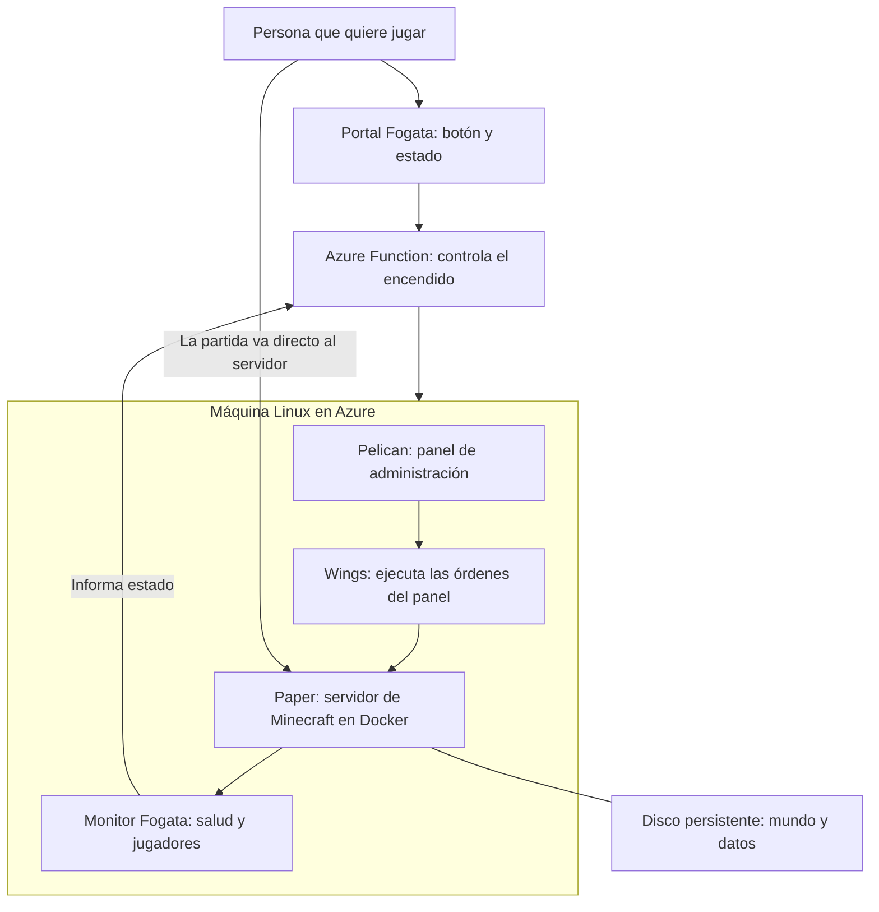
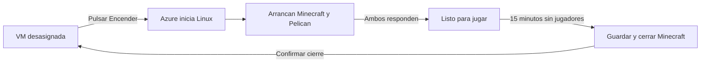

# Fogata: un servidor de Minecraft que se enciende cuando lo necesitamos

**Lectura: unos 4 minutos.**

La idea es sencilla: tener un mundo compartido sin pagar una máquina encendida todo el mes. Antes de jugar, alguien abre una página, introduce la contraseña y pulsa **Encender**. Mientras espera, ve el avance del arranque y puede entretenerse con un minijuego. Cuando el juego y el panel están listos, ya puede entrar.

Al terminar la sesión, el sistema espera 15 minutos sin jugadores, guarda el mundo y libera la máquina en Azure. La próxima vez recuperamos el mismo mundo y la misma dirección.

## La foto completa

El portal y el controlador siguen disponibles cuando la máquina está apagada. Minecraft y Pelican viven juntos dentro de ella. Por eso **podemos encenderla desde la web, pero el panel solo está disponible cuando la máquina está funcionando**. La partida no pasa por la web ni por la Function.

## ¿Qué hace Pelican y qué hicimos nosotros?

**Pelican es el escritorio de administración del servidor.** Nos permite abrir la consola, revisar archivos, configurar el juego y gestionar plugins sin hacerlo todo por terminal. Es un proyecto de código abierto que aprovechamos, no un panel que hayamos construido desde cero. [Así lo describe el proyecto](https://pelican.dev/docs/).

Su compañero, **Wings**, recibe las instrucciones y administra el proceso de Minecraft dentro de un contenedor Docker. **Paper** es el software que ejecuta el juego y permite usar plugins.

**Fogata aporta el encendido y apagado de la infraestructura:** la página con el botón, el controlador de Azure, el monitor de jugadores y los scripts para desplegar una copia. Pelican puede detener Minecraft; Fogata da el paso adicional de liberar la máquina para dejar de pagar cómputo.

Docker se ejecuta en Azure. Quien despliega desde su PC no necesita instalar Docker Desktop.

## Qué ocurre al jugar

En una prueba completa, pasar del botón al estado listo tomó **unos 108 segundos**. Medimos alrededor de **140 ms de latencia desde el equipo de prueba en Chile**. Son mediciones de esa conexión, no tiempos garantizados; falta evaluar una sesión con varios jugadores. El detalle está en [el registro de validación](VALIDACION.md).

La máquina elegida es una **Ubuntu con 2 vCPU y 8 GB de RAM, D2as_v7, en Central US**. Priorizamos costo frente a Brazil South. Es una VM normal por consumo, no Spot: preferimos evitar que Azure pueda recuperar capacidad e interrumpir una partida por ese motivo.

## Cuánto cuesta, a grandes rasgos

El ahorro principal viene de las horas apagada. Con las tarifas de referencia consultadas el **7 de noviembre de 2026**:

| Uso de la VM en Central US | VM + disco + IPv4 fija |
|---|---:|
| 60 horas al mes: unas 2 horas al día | US$13,90/mes |
| 180 horas al mes: unas 6 horas al día | US$24,79/mes |

**Son estimaciones parciales, no la factura final.** Hay que sumar almacenamiento auxiliar, operaciones, backups, transferencia cobrable e impuestos cuando correspondan. La [comparación de costos del README](../README.md#costos-y-controles) explica los supuestos y enlaza las fuentes.

El disco SSD de 64 GB y la IPv4 fija suman aproximadamente **US$8,45 mensuales incluso con la VM apagada**. Guardan el mundo y reservan la dirección. El nombre gratuito de Azure evita comprar un dominio propio.

La Function usa **Flex Consumption**, sin instancias permanentemente listas. Tiene franquicias gratuitas sujetas a la oferta y al consumo de la suscripción; no equivale a uso ilimitado gratis. El portal usa Azure Storage, que también tiene pequeños cargos por almacenamiento y operaciones. [Precios de Functions](https://azure.microsoft.com/en-us/pricing/details/functions/).

Las horas se cuentan por máquina: cuatro personas jugando dos horas consumen dos horas de VM. Más jugadores sí pueden aumentar el tráfico y las necesidades de rendimiento.

## Qué cuidamos y qué viene después

El controlador tiene límites de **180 horas mensuales y 8 horas por sesión**, además del apagado por inactividad. La web exige contraseña y el controlador usa una identidad con permisos limitados a esa VM. Las credenciales y los mundos quedan fuera de GitHub.

Estos controles ayudan a contener gasto; no garantizan una factura máxima de US$50. El crédito de Visual Studio tiene condiciones de uso individual para desarrollo y pruebas que cada propietario debe revisar antes de desplegar. [Condiciones del beneficio](https://learn.microsoft.com/en-us/visualstudio/subscriptions/faq/subscriber/azure/).

Ya comprobamos encendido, apagado con guardado y recuperación del mundo. Los siguientes pasos son probar una partida con varios jugadores, revisar el gasto real y automatizar backups con una restauración de prueba. **Conservar el disco al apagar protege la continuidad; tener una copia aparte protege el mundo.**
